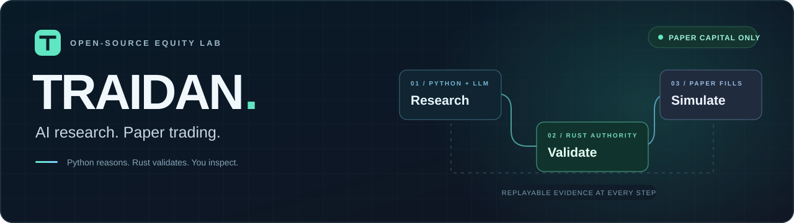
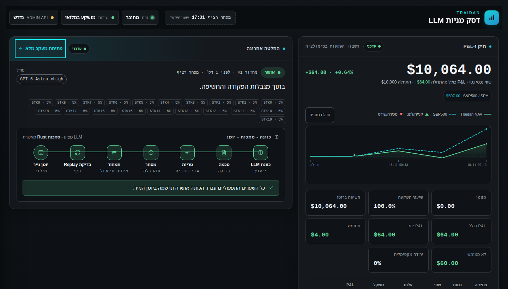
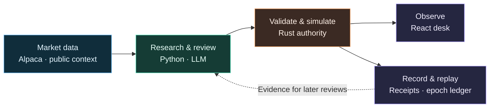

<div align="center">
  

  <p><strong>An AI-powered equity research desk. A Rust-validated paper portfolio.</strong></p>

  <p>
    <a href="LICENSE"></a>
    
    
    
    
  </p>

  <p>
    <a href="#the-desk">The desk</a> ·
    <a href="#how-it-works">How it works</a> ·
    <a href="#quick-start">Quick start</a> ·
    <a href="#explore-the-project">Documentation</a>
  </p>
</div>

---

Traidan turns U.S. equity market data into model-selected portfolios, validates
each rebalance in Rust, and makes the decisions visible in a live dashboard.
It combines research, simulated execution, and replayable evidence in one
open-source system.

> **Paper capital only.** This version cannot submit live broker orders.
> Alpaca supplies market data; all portfolio fills are simulated.

| Starting paper capital | Target portfolio | Per-position limit | Live broker orders |
| :---: | :---: | :---: | :---: |
| **$10,000** | **20–40 holdings** | **5% of NAV** | **Disabled** |

## The desk



<p align="center"><sub>Actual dashboard rendered with synthetic test fixtures. Illustrative values, not investment results. The interface supports Hebrew and right-to-left layout.</sub></p>

| 🧠 Model-led research | 🦀 Rust authority | 🔎 Inspectable decisions |
| --- | --- | --- |
| Broad symbol discovery, market context, and complete portfolio proposals. | Freshness, schema, allocation, and accounting checks before an atomic simulated rebalance. | Portfolio state, decision traces, durable receipts, and replayable audit records. |

## How it works



1. **Discover.** Build a research slate from active U.S. equities, market movers, current holdings, and public context.
2. **Review.** The model proposes a complete allocation with evidence and rationale.
3. **Validate.** Rust checks the proposal against the current account and executable market snapshot.
4. **Simulate and inspect.** Commit the rebalance atomically, retain its receipt, and stream the result to the dashboard.

The local launcher defaults to `paper` with
`TRAIDAN_LLM_EQUITY_RISK_MODE=fully_invested`. Direct service starts remain
`shadow` and bounded by default. Rejected replacements preserve existing positions.
See the [runtime reference](docs/RUNTIME_REFERENCE.md) for allocation rules,
scheduling, cost accounting, legacy modes, and recovery behavior.

## Quick start

**You’ll need:** Rust stable, Python **3.11–3.13**, Node.js **22.12+**, Alpaca
market-data credentials, and an authenticated Codex CLI with access to the
configured review model. The current review profile is `gpt-6-astra` / `xhigh`.

### 1 · Install

```bash
git clone https://github.com/RalbagI/Traidan.git
cd Traidan

python3 -m venv .venv
source .venv/bin/activate
python -m pip install -e '.[dev]'
(cd frontend && npm ci)
```

### 2 · Configure market data

Supply credentials through your environment or the ignored local runtime file
as described in the [credential setup guide](docs/RUNTIME_REFERENCE.md#local-run).
Never commit keys or runtime state. Review the
[operator runbook](deployment/operator-runbook.md) for admin-token and loopback requirements.

### 3 · Start the paper desk

```bash
scripts/local-dry-run.sh start
scripts/local-dry-run.sh status

# When finished
scripts/local-dry-run.sh stop
```

| Surface | Local address |
| --- | --- |
| **Dashboard** | [127.0.0.1:5173](http://127.0.0.1:5173) |
| Admin API | `http://127.0.0.1:8090/admin/status` — bearer token required |
| WebSocket | `ws://127.0.0.1:8080/stream` |
| Metrics | `http://127.0.0.1:9100/metrics` |

## Explore the project

| I want to… | Start here |
| --- | --- |
| Understand the design | [Architecture](architecture.md) |
| Run, stop, and troubleshoot the desk | [Operator runbook](deployment/operator-runbook.md) |
| Inspect policies, scheduling, and APIs | [Runtime reference](docs/RUNTIME_REFERENCE.md) |
| Configure my own public deployment | [Release and setup notes](docs/OPEN_SOURCE.md) · [WSS guide](deployment/wss/README.md) |
| Explore the research and execution code | [Python research](intelligence/llm_equity) · [Rust engine](src) · [React dashboard](frontend/src) |
| Inspect the data contracts | [JSON schemas](schemas) |

<details>
<summary><strong>🧪 Run the verification suite</strong></summary>

From the repository root, with the Python environment activated:

```bash
cargo fmt --check
cargo clippy --all-targets --locked -- -D warnings
cargo test --all --locked
python -m ruff check .
python -m mypy intelligence/
pytest
(cd frontend && npm test && npm run build)
```

Dashboard fixture screenshots are available through
`npm run test:dashboard-screenshots` from `frontend/`.

</details>

---

<div align="center">
  <p><strong>Research in the open. Inspect every decision.</strong></p>
  <p>Maintained by <a href="https://github.com/RalbagI">RalbagI</a> · <a href="LICENSE">MIT licensed</a></p>
  <p><sub>Bundled Noto fonts retain their <a href="frontend/src/assets/fonts/LICENSE-NOTO.txt">SIL Open Font License</a>.</sub></p>
</div>
