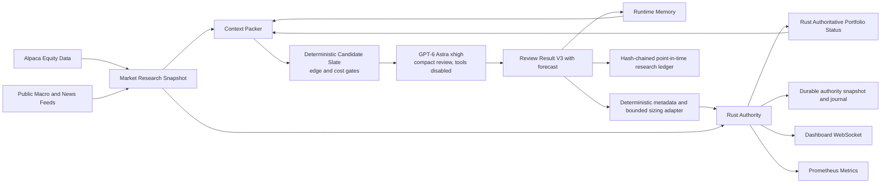

# Traidan Architecture

## Product Boundary

Traidan is a simulated U.S. equity research and paper-trading system. The local
launcher defaults to `paper` plus `TRAIDAN_LLM_EQUITY_RISK_MODE=fully_invested`.
Direct binary starts remain shadow and bounded by default, and neither mode has
a live-capital path.
Deterministic code collects point-in-time data, proposes candidates, validates
contracts, owns risk and sizing, simulates fills, accounts for the portfolio,
and publishes telemetry. The LLM is a sparse semantic reviewer and cannot
authorize fills.

Version 1 never submits broker orders and never uses live capital.

## Runtime Flow



## Schedules

All scheduling uses `America/New_York`.

| Time | Action |
| --- | --- |
| Every hour at `hh:05` | Broad public-news/event scan; authoritative-clock-open RTH scans target an accepted `$25` total only after the post-cost edge gate passes |
| 09:00 and 09:15 | Prepare a model-generated `$100` opening intent; no command is posted |
| 09:30 | Release a revalidated positive-edge intent, or rebuild a current `$100` intent after fresh edge validation |
| 10:35, 12:35, and 14:35 | Broad-market paper discovery targets an accepted `$100` total only after the edge gate passes |

The former hourly full-market LLM research cadence is now a daily pre-open
workflow. During the rest of the day, hourly cycles scan public news and event
feeds first. Authoritative-clock-open RTH cycles invoke the pinned model only
when the deterministic freshness, evidence, spread, and post-cost edge gates
pass. A valid model-generated `$25+` intent is posted to Rust; Rust rejection
may trigger two bounded fresh model reviews, after which the cycle is blocked.
A no-edge cycle records a zero-cost abstention. Outside RTH, news scans record
research-only audit rows and never post commands.
Every model review also receives the next four scheduled cycle slots, including
their New York run time, session, release target, and minutes until execution.
This schedule is advisory planning context; it does not cause an early run or
change scheduler ownership.
Three bounded RTH discovery cycles also build the full dynamic market slate so
paper learning does not depend exclusively on breaking news. They retain the
same freshness, consensus, evidence-family, spread, cost, LLM-veto, and Rust
authority gates. For an eligible positive-edge RTH slot, the accepted-total
target is `$25` for news scans and `$100` for release/discovery cycles. Rust
remains the authority that can reject an order. The local launcher disables
`least_bad_forced`, so a negative-edge slate cannot become a required entry.
Low-signal news scans stay public-news-only outside RTH. During an open
authoritative RTH session they build the full Alpaca quote/bar context and
may invoke the model when the full edge gate passes even if the event score is
low. Outside RTH their lightweight
public-news context remains Python-local
and is not sent through the strict tradable market-snapshot contract. Instead,
the service-status update carries the current market-session label so Rust can
publish scheduler health and the dashboard can show the active session before
any trade cycle exists. The dashboard retains terminal research-only and
edge-gated statuses as completed scan activity, with the LLM and Rust gates
explicitly marked not evaluated; it does not invent a tradable snapshot or
decision. A stable summary/event activity key collapses repeated checks of the
same unchanged opportunity into one timeline row while retaining a repeat
count and the latest scheduler receipt. Partial stale-slot audit stubs follow
the same rule:
they remain audit-only and publish session/status metadata without entering the
tradable snapshot field.

The Python service is invoked as:

```bash
PYTHONPATH=intelligence python3 -m llm_equity.hourly_service run
```

The LLM command builder preserves this required prefix:

```bash
codex exec --model gpt-6-astra -c model_reasoning_effort="xhigh"
```

The hourly service and new research runs both pin this model and effort.
Audit schemas accept `gpt-6-astra` and the prior `gpt-5.6-sol` model identifier,
so existing audit history remains readable through the v1, v2, and v3 readers.

The service adds a sanitized environment, ephemeral working directory,
read-only sandbox, strict output schema, one decision call plus at most two
model-only recovery calls, and disables shell,
MCP/plugin, browser, image, computer-use, and multi-agent tools.

## Data Layer

`intelligence/llm_equity/alpaca.py` reads active/tradable U.S. equity assets,
top stock movers (maximum 50), most-active stocks (maximum 100), stock
snapshots, and market clock state from Alpaca. Minute, current-session, and
previous-session bars remain distinct. The adapter is read-only. Coverage depends on the
operator's Alpaca data subscription; stale or unavailable sources are recorded
in the snapshot and produce explicit rejection behavior.

`intelligence/llm_equity/hourly_service.py` also refreshes macro and news
context on every executed startup or scheduled research cycle. Feed overrides
are newline-delimited or JSON arrays so commas inside query strings remain
intact. Defaults are Federal Reserve
monetary-policy RSS, Census economic-indicator RSS, Yahoo Finance headlines for
core research anchors, and CNBC markets RSS. Operators can override these feed
lists with `TRAIDAN_LLM_EQUITY_MACRO_FEED_URLS` and
`TRAIDAN_LLM_EQUITY_NEWS_FEED_URLS`, or disable fetching with
`TRAIDAN_LLM_EQUITY_CONTEXT_AUTO_FETCH=0`. Feed failures are represented as
unavailable snapshot rows, not as synthetic bullish or bearish input.

Hourly `news_scan` cycles use the same summary-only feed parser with an expanded
public-source default that includes GDACS, USGS significant-event Atom, Hacker
News RSS, and the existing market-news feeds. Deterministic public-event cards
map summary text to compact impact paths such as memory semiconductors,
AI-compute supply chains, rates/liquidity, geopolitical energy risk,
cloud/cyber disruption, and physical hazard supply chains. The first public
memory-semiconductor rule explicitly maps DRAM/NAND/HBM, Micron, SanDisk,
Western Digital, Samsung Electronics, and SK Hynix mentions to MU, SNDK, WDC,
STX, SMH/SOXX, XLK, and NVDA candidates when those symbols can be priced.
Event intelligence remains Python-context-only and stores summary, URL,
timestamp, hash-derived ids, impacted symbols, impact path, freshness, and
quality flags. It does not store full article text, raw social content, provider
payloads, credentials, or raw prompts.
The feed collector fetches every configured public source and selects its
bounded six-item packet in round-robin order. This guarantees that finance
feeds are represented when available instead of allowing earlier disaster or
technology feeds to consume the entire packet.

Alternative-data expansion is represented by
`config/alt_data/source_catalog.json` and the additive
`config/alt_data/telegram_watchlist.json`. The merged source registry preserves
the original 50-source catalog invariant, adds public Telegram metadata sources
only, and starts every source behind `configured`, `credentialed`,
`legal_approved`, `canary`, `paper_context_enabled`, and `live_disabled` gates.
The active hourly prompt receives registry and connector-plan summaries, but no
new connector is promoted into paper context or live capital by default.
The public news-scan wave uses only public, summary-only sources and does not
flip the registry paper/live activation gates. Reddit/X, paid DRAM/NAND pricing,
unusual options, Polygon, Stocktwits, NewsAPI, and other credentialed or paid
sources remain disabled follow-up items until explicit legal, billing, provider,
and retention approvals exist.

QuestDB artifacts for this pivot:

- `deployment/questdb/003_llm_equity_dry_run.sql`
- equity bars and quotes
- market research snapshots
- LLM decisions
- simulated fills
- memory events

## Contracts

The active JSON contracts live under `schemas/`:

- `llm_review_result_v3.schema.json`
- `llm_review_result_v3.codex.schema.json` (the strict-Structured-Outputs
  transport subset for Codex; the full review-result schema remains the
  deterministic acceptance contract after model output returns)
- `llm_trading_decision.schema.json`
- `market_research_snapshot.schema.json`
- `llm_memory_event.schema.json`
- `llm_equity_cycle_audit_v3.schema.json`
- `llm_equity_cycle_audit_v2.schema.json`
- `llm_alpha_card.schema.json`
- `llm_trade_slate.schema.json`
- `llm_swarm_reflection.schema.json`

Runtime payloads must not contain raw prompts, raw logs, credentials, full
article text, or schema-unknown debug fields. Macro and news adapters store URL,
retrieval time, freshness, and summary only.

The Python service records epoch-scoped audit, replay, portfolio-history, and
strategy-learning artifacts under `.agent/state/llm-equity-dry-run/epochs/<epoch-id>/`.
The epoch fingerprint covers model, effort, prompt version, review-schema hash,
context budget, risk policy, and candidate-policy version. Audit records contain context and decision
hashes, byte counts, validation-attempt metadata, cost estimates, release slot
metadata, compact Rust authority status, and scalar swarm metadata: agent count,
AlphaCard count, consensus score, edge-gate status, selected strategy book, and
no-trade reason. Additive attribution fields record scrubbed portfolio NAV,
paper P&L, gross exposure, benchmark-relative net alpha, whether the LLM was
actually invoked, the cost basis used for the row, and validation repair count.
An optional backward-compatible `review_attestation` records required,
compliant, or failed model-review status, the pinned model and reasoning effort,
total invocations, model-selected action/notional, Rust-accepted side/notional,
and cumulative accepted total. Historical V2 rows may also carry a bounded
`dashboard_summary_thesis` copied from scrubbed command rationale for the
operator cycle ledger plus accepted-trade summaries containing only the actual
accepted symbol, buy/sell action, notional, horizon, pending-outcome status, and
add/reduce classification. `mandatory_trade_status` remains the separate
execution outcome; blocked attempts stay in audit/status history instead of the
accepted trade-cycle ledger.
New audit records use V3 and also record the strategy epoch/fingerprint, risk
mode, typed forecast, source-health reasons, model-cost basis,
`imputed_api_cost_usd`, and accepted/blocked forced-trade status. Readers retain
V1/V2 compatibility.
Rows are additionally appended to a hash-chained `research-events.jsonl` ledger
that is not capped at 500 entries. Rows skipped by deterministic gates keep modeled preflight cost separate from
actual LLM spend so non-RTH or stale-context skips are not counted as model
spend. They intentionally do not copy raw prompts, subprocess logs, full
context packs, full decisions, credentials, or article text.

## Rust Authority

Rust owns:

- strict payload parsing
- replay and sequence rejection
- symbol syntax and command-price availability checks
- session and freshness checks
- credential/raw-content rejection
- simulated fills
- portfolio accounting
- shadow-by-default fill containment
- borrow, concentration, gross/net, cash, turnover, daily-loss, and drawdown gates
- bid/ask plus market-impact paper fills
- atomic authority recovery state and append-only journal
- kill-safe state reporting
- WebSocket and metrics telemetry

The primary internal authority endpoint is:

```text
POST /internal/llm-equity/cycle
```

It is localhost-only and bearer-token authenticated. The body contains
`market_research_snapshot` plus `llm_trading_decision`.

The dashboard-only cycle ledger endpoint is:

```text
POST /internal/llm-equity/cycle-summary
```

It is also localhost-only and bearer-token authenticated. The body is the
scrubbed cycle-audit summary: cycle id/kind, market session, status,
mandatory-trade status, required/requested/accepted notional, actions,
symbols, rationale, reason, and timestamp. It never authorizes fills and cannot
mutate the Rust trading authority.
The HTTP parser accepts up to 80 action and symbol entries, preserving their
order and repetitions so a complete allocation retains every sell/buy pair.

## Deterministic Candidate Slate And Edge Gate

Before the LLM is asked for a review, Python builds a deterministic paper-only
candidate slate. Legacy `alpha_swarm` field names remain wire-compatible but
do not represent independent LLM agents. The default
paper exploration mode is `TRAIDAN_LLM_EQUITY_EXPLORATION_MODE=max_discovery`;
operators can set `balanced` to restore the narrower legacy exploration
posture. Max-discovery expands the pre-ranking U.S. equity research pool to
about 250 active/tradable symbols and retains a deterministic Top-12 slate.
Normal compact reviews include only the first five candidates whose individual
edge gate passed. Mandatory RTH reviews include the full bounded Top-12 ranked
slate; recovery reviews also prioritize an opposite-direction reduction for a
held position when that direction is absent from the ranked slate. Preparation
applies the normal admission logic to a projected RTH setup. Release requires a
fresh snapshot and revalidates the prepared decision; a missing or drifted
intent is rebuilt as a current mandatory review. Legacy swarm-role fields remain
deterministic telemetry; there is exactly one paid GPT-6 Astra xhigh call per
review attempt, no agent fan-out, and no tool access.

AlphaCards store only scrubbed metadata: symbol, side, horizon, edge type,
summary thesis, evidence-reference ids, confidence, heuristic expected alpha,
downside, spread, liquidity, invalidation, and agent role. The service then
evaluates the trade slate before any Rust POST. The alpha estimate is a bounded
service heuristic derived from intraday move, independent evidence count,
liquidity, and spread; it is not a guarantee of return. A command is posted
only when all edge checks pass:

- current market session is regular trading hours
- snapshot does not require hold because of stale or unavailable inputs
- consensus score is at least `0.65`
- at least two independent evidence families are fresh
- selected quote/bar is fresh and spread is at most `75` bps
- expected alpha clears spread, estimated slippage/model cost, and a `30` bps
  margin
- when an effective call cost is configured, expected alpha clears at least
  three times its NAV-equivalent cost and expected dollar alpha clears five
  times the call cost

Max-discovery adds paper-only discovery lanes for extreme momentum, event
dislocations, neglected equities, contrarian shorts, and frontier metadata
signals that survive the existing source-registry gates. These lanes are for
non-core exploration candidates; core benchmark and mega-cap anchors remain in
the normal ranked lane even when their selected side is short. Ranked candidates
carry scrubbed `discovery_lane`, `risk_tier`, `risk_adjusted_edge_bps`,
`tail_loss_bps`, `max_probe_notional_usd`, `paper_only_exploration`, and
`risk_budget_reason` fields. Up to five final Top-12 slots can be reserved for
speculative exploration, but stale/non-RTH, freshness, spread, evidence-family,
and no-edge gates remain authoritative.

### Fully invested paper policy

The default `paper + fully_invested` policy invests all current account NAV,
including gains, with at most $0.01 rounding residue. The model selects 20–40
stocks or approved equity ETFs with weights totaling 100%; each position is at
most 5% NAV at rebalance. The account is long-only, with no borrowing or cash,
Treasury, or cash-equivalent funds. Negative forecasts must be reported honestly
and do not permit abstention. The 3% daily-loss and 10% drawdown measurements
remain visible but do not block investment.

Every sale is part of a complete replacement portfolio. Rust solves quantities
after spread and modeled impact, validates all prices and the current account,
and commits the entire rebalance together. A rejected replacement preserves all
existing positions. The existing 4× NAV daily turnover cap still applies. The
model can keep the same allocation; the service does not require trading merely
to produce activity.

The service checks every 30 seconds for available cash, scheduled reviews,
5% price-stop triggers, and expired theses. Stops and expiry request a replacement
review, never automatic liquidation. Reviews use up to 100 eligible candidates
in a 96 KB packet and allow one model call plus two repairs. Quotes are refreshed
before execution; a move over 25 bps requires fresh model approval of the same
allocation at the new quotes. That short approval includes the original theses,
incoming and outgoing prices, and current evidence, and is bound to their digest.
A rejection triggers a new full selection. Quotes are checked again after approval,
and the complete cycle remains limited to three model invocations. Full selections
have a 600-second cap; price approvals have a 180-second cap, both respecting any
shorter configured timeout. A validated selection awaiting price approval survives
a cycle boundary or service restart for up to 15 minutes. The next cycle retries
approval after 30 seconds instead of discarding that selection; it still needs a
fresh model approval and executable quotes. Expired or newly ineligible selections
return to full selection. Original selection and later approval remain linked in
the audit, with each invocation counted in its own cycle. Unavailable data,
a closed market, or a failed model review leaves existing investments intact
and publishes the actual blocked reason. Any cash awaiting its initial allocation
is shown as incomplete, with retries during fresh, open regular-session trading.
There is no deterministic ETF fallback.

Each accepted allocation has a durable Rust receipt. An interrupted submission
retries the exact payload, including after restart, without executing it twice.
The audit retains every accepted order and the model's review and repair reasons.
Policy migration preserves the actual account and does not assign blanket expiry
times to inherited holdings. Historical `profit_driven` records remain readable.

### Profit-driven paper policy

The legacy `paper + profit_driven` policy removes trade quotas and the exposure
floor. The model may enter, increase, hold, reduce, close, or abstain; every
entry/increase still requires a positive after-cost LLM forecast. Python caps
the resulting position at 5% NAV and planned stop loss at 0.25% NAV, with at
most 10% NAV of new exposure per review. Rust retains the existing upper
portfolio limits, including 3% daily loss and 10% drawdown. Daily loss stays
latched until the next session and drawdown stays latched across recovery and
restart. A flat account cannot bypass a stop with a benchmark probe.

Only Rust-accepted entries create an explicit holding plan with thesis, stop,
and expiry. Increases cannot postpone expiry. Risk exits use `reduce_only`,
which Rust clamps to the current executable quantity; small residual positions
can close without opening a short. The service checks existing holding exits
on its 30-second scheduler polls without calling the model. A model review can
occupy the service for at most 180 seconds; stops execute at the next available
fresh RTH quote and cannot guarantee a price through a gap.

Discovery remains broad, while each model packet contains at most five new
candidates plus held inventory, within 96,000 bytes. Unchanged material evidence
skips another review. Typed model failures set bounded cooldowns; no failure
creates an entry. Executable quotes are fetched again after review, and a
material move requires new model approval. Premarket research keeps its actual
source timestamps and is revalidated for execution. The opening slot retries
readiness every 30 seconds for five minutes, requiring an open authoritative
clock and a completed opening bar. Optional missing candidates are filtered;
held-position valuation remains mandatory.

The forced-aggressive behavior below is retained for legacy configuration and replay.

For an edge-gated review, the LLM performs an independent final review
over at most five passing candidates. It returns zero to three V3 intents; zero
is an explicit abstention. For an eligible fresh RTH target cycle, the model
must return one to three intents including a `$25+` intent whose total covers
the remaining required amount. In local `paper + forced_aggressive` mode it sees
all 250 fresh-priced symbols and may choose either direction. Abstention, empty
output, or a sub-floor total fails; a deterministic fallback cannot satisfy the
review. Each intent classifies `positive_edge`, `least_bad_forced`, or
`risk_reduction`; the local profit-seeking policy rejects `least_bad_forced`
unless an operator explicitly restores legacy behavior. Every intent carries
expected excess return, probability positive, and
ordered p10/p50/p90 return quantiles. When no new candidate has positive cost-adjusted edge, the compact
review context exposes position value, unrealized P&L, and bounded reduction
capacity so the model can prefer reducing the weakest held exposure. Accepted
long reductions and short covers count toward the same floor; a reduction-only
intent is capped at the held quantity valued with Rust's executable-side paper
price (bid/ask plus modeled impact), floored to six decimals, so it cannot
reverse the position. Sizing keeps ranked risk tiers separate from held
inventory: only sells reducing a long or buys covering a short use the
held-position cap. Orders adding exposure retain the model's notional within
the existing intent, cycle, and speculative limits, even when the current
holding is worth less than `$25`. Prepared reductions are identified at prepare time and
recapped against the fresh release position and executable quote; a disappeared
or side-flipped holding removes that command and the existing bounded mandatory
review recovery obtains a current intent. A review may emit only one intent per symbol. Python
deterministically adapts valid intents into the V1 Rust contract.

Outside RTH the service runs research-only bookkeeping and returns
`skipped_no_edge` with edge status `skipped_non_rth`; the cycle audit status is
`research_only`, and it does not POST a trade command for Rust to reject. During
an eligible fresh RTH cycle, a decision made invalid by sizing, Rust rejection,
or a partial acceptance starts the bounded mandatory recovery path. Every
invalid resized decision, including each recovery attempt, is audited and
never posted to Rust. The compact recovery context keeps sanitized local
validation reasons separate from actual Rust rejections; a cycle with no Rust
submission has no Rust rejection reason. After two fresh recovery reviews without the
accepted required total, it records `llm_mandatory_trade_blocked` and awaits the
next scheduled cycle.

## Portfolio And Risk

The account starts with exactly `$10,000` cash and no positions. There is no
startup purchase. The first simulated order can only come from an accepted LLM
cycle.

Paper autonomy:

| Surface | Value |
| --- | --- |
| Market scope | Dynamic Alpaca active/tradable U.S. equities |
| Research slate | Max-discovery ranked top about `250`, or balanced top `100`, plus held/prepared command symbols |
| Deterministic trade slate | Adaptive Top `12` ranked candidates per cycle |
| LLM review candidates | First `5` passing candidates normally; an eligible local target cycle can expose all fresh-priced researched symbols, up to `250` |
| Static approved-symbol gate | none |
| Rust paper limits | Bounded mode: 7.5% name, 75% gross, 35% absolute net, 30% short gross, 25% cash reserve, 150% daily turnover, 1% daily loss, 5% drawdown, and a `$700` gross-exposure floor. Local `forced_aggressive`: 15% name, 125% gross, 75% absolute net, 60% short gross, 10% aggregate high-correlation proxy-group gross, 5% cash reserve, 400% daily turnover, 3% daily loss, 10% drawdown, the same `$700` gross-exposure floor, with tradability/borrow checks and reduction-only behavior after loss/drawdown |
| Mandatory order notional | Every Rust-postable decision keeps one command `>= $25`; accepted totals are `$25` for news and `$100` for release/discovery |
| Python forced sizing | standard intents are capped at 5% NAV each and 10% NAV per cycle; speculative intents remain capped at 0.5% NAV each and 1.5% total; reductions are capped at executable-side held exposure |
| Flat constrained exception | once daily-loss/drawdown is reached and the portfolio is flat, only the model-selected mandatory-floor SPY/QQQ probe is admissible |
| Commands per accepted cycle | `1..3` |

Allowed commands after the edge gate passes:

- `buy_notional`
- `sell_notional`

`sell_notional` may open or increase simulated short exposure, and either
`buy_notional` or `sell_notional` satisfies the mandatory `$25` order rule.
Rust-postable LLM decisions must use verdict `pass`; an explicit no-edge veto is
kept in Python audit state and never reaches Rust. Rust remains the sole
fill-acceptance authority and rejects posted commands on schema/security,
replay, timestamp, session, freshness, mandatory order notional, or missing
command-symbol price gates.
Risk-limited paper modes also require gross exposure to build through
`buy_notional` commands until it reaches `$700`; afterwards Rust rejects any
command projecting gross exposure below `$700`.

The Python service adds a deterministic profitability scorecard to context. It
includes NAV, realized and unrealized P&L, concentration/drawdown observations,
source-health gaps, SPY/QQQ/equal-weight researched-slate benchmark drift,
estimated model/data/hosting/execution costs, net alpha, Top-12 ranked trade
candidates, compact strategy-learning state, the RTH deterministic slate, and
sidecar strategy-lab marks. The paid review packet uses a configurable
`TRAIDAN_LLM_EQUITY_REVIEW_CONTEXT_MAX_BYTES` limit, clamped to 96-320 KB and
defaulting to 256 KB. Current quotes, risk headroom, execution costs, benchmark
state, candidates, source health, and settled forecast calibration take
priority. It excludes raw prior memory but may spend remaining space on
a compact `cycle_continuity` projection: the last 24 hours of scheduled and
ad-hoc cycle flow, up to 24 active trade theses, up to 24 individual recent
outcomes, and the next four scheduled slots. The row caps apply in addition to
the 24-hour window. Historical narrative is redacted, size-bounded, and
explicitly marked as untrusted advisory text. It cannot substitute for current
evidence, candidate eligibility, freshness, or Python/Rust gates. If continuity
state is missing the review starts cold; if an audit, memory, or
strategy-learning artifact is corrupt the service records an alert and
continues with degraded, stateless continuity. Normal reviews contain at most
five passing candidates; eligible local `forced_aggressive` target reviews
contain all fresh-priced researched symbols up to 250. Before Rust posting,
Python rejects
commands
outside the current candidate directions in bounded mode and otherwise
preserves the model-selected notional, except that an explicit reduction-only
intent is capped at held exposure; Rust applies executable limits.
`source_registry.frontier_discovery` is an advisory paper-context marker for
neglected or unusual public metadata; it does not bypass the authoritative
ranked-candidate, freshness, spread, consensus, risk-budget, and edge gates.
`public_event_intelligence` is another advisory context block. It can raise a
candidate's event opportunity, impact-path, and quantamental scores, but it
cannot create a Rust-postable command unless the symbol is priced in the
snapshot and the LLM returns a valid decision. Normal reviews also require the
passing review Top-5 and RTH edge gate; mandatory `forced_aggressive` reviews use
the full fresh-priced research slate and remain subject to Rust hard gates.
Snapshot freshness is anchored to a retrieval-time `as_of` captured after the
Alpaca response. The scheduler's earlier cycle timestamp remains scheduling
metadata and cannot turn quotes received after a slow public-news fetch into
false future-skew failures. Genuine freshness or authoritative-clock failures
audit as `skipped_stale`. If retrieval crosses the close, the authoritative
snapshot is classified after-hours, remains research-only, and is excluded from
the observed-RTH denominator. If fixed local hours say RTH while the fresh
authoritative clock is closed for a holiday or early close, the safe block stays
in the observed-RTH denominator and is classified as a hard-gate outage.

The official book remains the Rust paper portfolio. In parallel, the Python
context records sidecar virtual books for `small_consensus`, `kelly_aggressive`,
`contrarian`, `news_drift`, and `macro_hedged`. These are strategy-lab marks
derived from the same snapshot and simulated mark data so operators can compare
which swarm sizing style would have generated net alpha without changing the
Rust fill authority.

Strategy learning is paper-only and delayed. Accepted commands create pending
outcomes in isolated `30m`, `60m`, `close`, `1d`, or `5d` sleeves with symbol,
side, strategy book, entry mid, notional,
benchmark entry marks, spread, model-cost, and technical-confluence metadata.
The pending queue is bounded to the latest 500 outcomes. Every cycle — posted,
prepared, or skipped — settles due outcomes during context building
(`strategy-learning.json` schema v3): pending-outcome symbols are injected into
the snapshot's required symbols (bounded to 16) so exits stay priceable, exit
prices prefer the 1-hour historical bar at the exact settlement horizon when
technicals history was fetched, and neither snapshot marks nor historical bars
are eligible unless their timestamp is at or after the horizon and at or before
the cycle's authoritative `as_of`. Each accepted command retains its
originating cycle, command index, and memory-event link. Outcomes that stay
unpriceable past
`TRAIDAN_LLM_EQUITY_OUTCOME_MAX_AGE_MINUTES` (default 14400) expire into a
`settlement_stats` counter block. Both settled and expired outcomes are also
appended individually to a bounded 500-row `recent_outcomes` journal, which
feeds the 24-hour continuity projection and makes the original thesis-to-result
link visible to later cycles.
Settled outcomes score symbol, strategy-book, discovery-lane, and
technical-confluence buckets by entry-spread/model-cost-adjusted alpha versus
SPY/QQQ drift and are removed so they cannot be counted twice. Executed
`buy_notional` and `sell_notional` actions are authoritative for long/short
attribution even when the deterministic candidate pointed the other way.
Schema v3 keeps symbol learning separately by direction and adds compact
direction sample counts and settled net alpha. On the first v3 read, an
existing v2 file is preserved once as `strategy-learning.v2.archive.json` and
learning restarts from a deterministic clean state. Sizing
multipliers are recomputed on read from confidence-weighted settled EWMA alpha
(acceptance rate contributes at most ±0.05), so schema-v1 files whose
multipliers were inflated by acceptance self-heal on first load. Execution
acceptance remains tracked separately from performance learning. Deterministic
candidate ranking uses the complete v3 direction-learning state before the
bounded compact projection is constructed for the paid LLM context.
Learned multipliers may reduce subsequent order size, but values above `1.0`
remain shadow telemetry and cannot increase paper orders. This asymmetric
policy stays in force until a frozen forward comparison promotes adaptive
sizing.

When `TRAIDAN_LLM_EQUITY_TECHNICALS=1` (default off, fail-closed), the service
fetches 1-hour historical bars from Alpaca for ranked candidates, benchmarks,
positions, and pending-outcome symbols (bounded by
`TRAIDAN_LLM_EQUITY_TECHNICALS_MAX_SYMBOLS`, default 24, over
`TRAIDAN_LLM_EQUITY_TECHNICALS_HISTORY_DAYS`, default 45) and computes
deterministic ICT/Wyckoff/Fibonacci detectors in
`intelligence/llm_equity/technicals.py`: three-candle fair value gaps, swing
pivots, market-structure shift on body close, the 0.618 golden pocket,
1-hour liquidity-sweep reversal triggers with stop levels, and Wyckoff
range/spring/LPS phases on session-anchored 4-hour aggregates. Results enter
the LLM context only — a rank-8 `technical_structure` evidence bundle plus
advisory per-candidate fields — and never the snapshot posted to Rust, whose
schema stays deny-unknown-fields; they are advisory evidence, not gates, and
byte-budget trimming drops them first. A `technical_buckets` learning section
(confluent/contra/none) measures whether confluence earns settled alpha before
any future gating decision.

## Counterfactual Research Simulation

The resident paper epoch is not reused for historical research. A separate,
paper-only coordinator replays the half-open `2026-05-03 00:00 ET` through
`2026-08-01 00:00 ET` window from immutable historical inputs under
`.agent/state/llm-equity-research/runs/<run-id>/`. Each of five isolated arms
starts at `$10,000`: anonymized/frozen, anonymized/adaptive,
semantic/frozen, semantic/adaptive, and the as-built single-reviewer reference.
The semantic arms are exploratory because model memory can include historical
events; full-period results are descriptive, and the final ten sessions after a
five-session purge are the untouched historical lockbox. Historical results can
select a paper candidate, but cannot authorize live trading. Promotion requires
a separately frozen epoch with at least 90 future paper sessions, 60 closed
simulated trades, and 100 matured forecasts.

The research entrypoint is:

```bash
scripts/research-simulation.sh prepare
scripts/research-simulation.sh run
scripts/research-simulation.sh resume
scripts/research-simulation.sh verify
scripts/research-simulation.sh analyze
scripts/research-simulation.sh export
```

New runs use `prepare --symbol-master <official-file> --universe-size 100
--side-policy long-only --feed auto-authorized`, `run --protocol swarm-v2`,
`verify --strict-economics`, `analyze --trial-registry canonical`, and `export
--receipt`. Stored Swarm V1 runs remain readable and replayable.

The launcher reuses the existing ignored Alpaca environment file (or an
explicit `TRAIDAN_ALPACA_ENV_FILE`) through an allowlist and never prints its
contents. `prepare` accepts an already-sanitized authorized source bundle, an
explicit historical symbol universe, or an official dated FINRA CAT equity
symbol-master file through `--symbol-master`. The symbol-master route selects a
fixed 100-symbol long-only universe before the window, anchored by SPY and QQQ,
plus deterministic active, volatile, and neglected-liquidity lanes. Eligibility
requires a last close of at least `$5` and median dollar volume of at least `$20
million` using only the preceding 20 completed Alpaca daily-bar sessions. The
source file hash and creation timestamp become canonical lineage. The exact
already-authorized Alpaca feed is frozen; `auto-authorized` never purchases or
changes a data subscription.

Direct collection fetches raw historical bars, summary-only historical news,
historical corporate actions, historical quotes, and the official calendar
from the configured Alpaca account. Quote API pages are streamed into
per-symbol, per-session immutable binary partitions, compacted to the last
valid quote in each second, and then copied into the
content-addressed store; preparation, cutoff lookup, checksums, and verification
do not aggregate the three-month quote corpus in memory. Direct preparation
also rejects any historical surface that still has a continuation token at the
configured page ceiling instead of accepting a truncated dataset. Individual
zero-bid or crossed provider quotes are quarantined, counted, and reflected in
the run's limited-scenario completeness reasons; they are never exposed to an
agent or execution snapshot and no longer discard otherwise valid history. It
never calls current snapshots, screeners, assets, movers, most-active, or the
current market clock. V2 quote records retain bid/ask sizes when Alpaca supplies
them, while V1 price-only partitions remain readable.
Official public macro archive observations may be supplied separately. Every
observation carries `event_time` and `available_at`; incomplete bars, future
observations, unsupported or late corporate actions, and unverified historical
borrow fail closed. Supported splits, cash dividends, and symbol changes use a
conservative availability time based on the first official session after the
provider process date. Movers and most-active lists are rebuilt from eligible
raw observations at each cutoff. Most-active ranks use cumulative official-RTH
volume rather than the latest minute. Candidate features include official-open
gap, 5/15/30/60-minute returns, cumulative volume, same-time relative volume,
VWAP, realized volatility, ATR, spread, quote age, SPY/QQQ/IWM relative moves,
breadth, news intensity, and macro-release proximity. News is deduplicated by
article ID. Missing source families give the run a `limited_scenario`
completeness grade.

Every official full session has two premarket preparation cycles and ten RTH
cycles; early-close cycles after the official close are omitted. Each RTH swarm
cycle runs eight isolated specialists with maximum concurrency four, followed
by one arbiter. Swarm V2 sends all eight closed envelopes to the arbiter,
including valid typed abstentions. A trade is blocked below six valid
invocations, whenever the risk/cost specialist fails or vetoes, or whenever a
deterministic data/risk gate is closed. The contrarian role emits downside,
avoidance, or reduction forecasts and cannot originate a short. Hard-gated
cycles still run all nine calls in diagnostic-only mode.
Only the arbiter can choose an order, and Rust remains the fill/risk authority.
Measured parallel-call latency advances the simulated clock before a fresh
execution snapshot is selected. A partial or rejected fill permits at most two
additional arbiter-only reviews.

Model evidence packs stay bounded across the replay: they expose only the
latest eligible bar, quote, and borrow state per symbol plus the 40 most recent
eligible news, macro, or corporate-action records. The coordinator rejects any
serialized research input above 500,000 characters before starting Codex.

The `llm-equity-research` Rust binary is a research-only stdin harness around
`LlmEquityDryRunAuthority::apply_json` with an injected `simulated_received_at`.
Swarm V2 uses its research-only `long_risk_adjusted` policy: 7.5% per name, 75%
long gross/net, 25% cash, 150% daily turnover, 1% daily loss, and 5% drawdown.
The coordinator applies volatility-scaled half-Kelly sizing clipped to
`$25`-`$750`.
The coordinator exports each arm's isolated authority state into a
content-addressed terminal checkpoint and restores only that committed state
after a crash. The harness applies verified splits, cash dividends, and symbol
changes before eligible cycles. The existing HTTP endpoint, live clock, Review
V3 contract, paper limits, and lack of any live-capital route are unchanged.

Canonical state uses content-addressed sanitized objects, daily cross-file
hash-chained events, per-cycle checkpoints, final SHA-256 checksums, and a
rebuildable SQLite index. It stores structured outputs, model/effort/catalog
and template/schema hashes, token usage, latency, exit status, validation,
redacted errors, cost components, state hashes, and lineage references. It
rejects raw prompts, chain-of-thought, raw stdout/stderr, article bodies,
credentials, and secret-bearing fields. Resume requires identical code, model,
schema, template, dataset, calendar, policy, and catalog fingerprints.
Canonical invocation events can be supplied directly to `--stored-outputs` for
a no-model-call deterministic replay only when the source is a verified
canonical run with matching fingerprints. Each replayed call is bound to a
prompt-free content-addressed envelope containing the exact serialized input
hash, evidence pack, diagnostic mode, and any arbiter envelopes; recovery calls
store their accepted-so-far and Rust-error context separately. Remaining
positions and all benchmarks are marked once more at the final eligible quote
before the half-open cutoff. A complete run is invalid if any final position is
unpriced or any final SPY, QQQ, cash, equal-weight, or deterministic Top-1 mark
is absent. Verify, analyze, and export also reject a missing checksum envelope
instead of silently regenerating one.
Forecast IDs are coordinator-owned (`invocation_id + ordinal`), `1d` and `5d`
horizons count official trading sessions, aliases are restored before scoring,
and adaptive reliability buckets use matured role/horizon/direction/regime net
alpha after QQQ, spread, impact, and commission costs. Analysis derives lockbox
dollar P&L from the actual lockbox-start and terminal NAV. Because simulated
fill prices already embed spread and impact, the ordinary cost-adjusted result
subtracts only commission, carrying, and model costs absent from NAV; the 2x
execution stress adds one extra spread/impact layer and a second commission
layer. It also uses a canonical inspected-trial count for DSR, SPY/QQQ block
bootstrap, and detached export receipts.

Research-only closed contracts are:

- `llm_research_run_manifest.schema.json`
- `llm_research_event.schema.json`
- `llm_research_specialist_invocation.schema.json`
- `llm_research_arbiter_provenance.schema.json`
- `llm_research_learning_delta.schema.json`
- `llm_research_rust_execution.schema.json`
- `llm_research_specialist_result.schema.json`
- `llm_research_arbiter_result.schema.json`
- `llm_research_specialist_opinion_v2.schema.json`
- `llm_research_arbiter_decision_v2.schema.json`
- `llm_research_forecast_outcome.schema.json`
- `llm_research_trial_registry.schema.json`
- `llm_research_export_receipt.schema.json`

The model-facing specialist and arbiter contracts deliberately use Codex's
supported strict-schema subset. Conditional trade/abstain invariants and
reference uniqueness remain fail-closed in deterministic post-transport
validation.

Reports retain separate anonymized, semantic-exploratory, lockbox, and
full-period conclusions; itemize execution, financing, borrow, fixed, actual
model, and imputed API costs; and use a fixed-seed 10,000-sample paired
five-session block bootstrap plus PSR, DSR across every inspected arm, and
Holm-corrected comparisons. Results are conditional counterfactual evidence,
not proof or a guarantee, and this calendar window does not satisfy Traidan's
90-trading-day promotion requirement.

Research finalization is fail-closed. Exhausted infrastructure failures append
a terminal `run_failed` event, update the manifest, refresh checksums, and
require an explicit fingerprint-matched resume. Before arm finalization, every
priceable outcome through the half-open cutoff is matured and the terminal
learning state is content-addressed. Research-only corporate-action handling
treats exact self-symbol changes as idempotent and prunes sub-cent economic
dust before collision checks. Analysis marks a lockbox with no accepted cycles,
incomplete outcome accounting, persistent operational blocking, incomplete
per-invocation token/cost telemetry, incomplete final valuation or benchmarks,
failed strict economics, or unknown model cost as ineligible performance
evidence.

## Profitability Gate

There is still no live capital path. Promotion from paper to live is disabled
until a separate approval verifies at least 90 trading days of replayable paper
results, positive absolute net P&L after all fixed and variable costs,
outperformance versus SPY and QQQ, no accepted fills
from stale source cascades, and hash verification of the sanitized point-in-time
research ledger. The local cycle-audit ledger is the operator-facing summary
index for compiling this gate evidence: it links each cycle to scrubbed context
and decision hashes, validation repairs, cost estimates, release slots, and Rust
acceptance or rejection status.

Break-even is tracked as:

```text
required_monthly_alpha_usd = model_cost + data_subscriptions + hosting + estimated_spread_slippage_borrow_fees + safety_margin
```

Token estimates and actual JSONL usage counts remain capacity telemetry. With
the default `TRAIDAN_LLM_EQUITY_MODEL_COST_BASIS=subscription_zero`, subscription
inference is charged at zero marginal strategy cost and the former `$750` floor
does not apply. `imputed_api_cost_usd` retains the operator-configured effective
call cost as sensitivity and is zero when
`TRAIDAN_LLM_EQUITY_EFFECTIVE_CALL_COST_USD` is unset; token counts are recorded
separately and are not converted through an implicit provider price table.
`configured_api` restores charging from the operator-configured effective call
cost and monthly model budget. Existing `TRAIDAN_LLM_EQUITY_MONTHLY_*` and legacy
`TRAIDAN_LLM_MONTHLY_*` cost envs remain supported for operator compatibility.
If model invocations exist while both actual and imputed model cost are zero,
the report emits `model_cost_integrity.status=cost_unknown` and fails the
`known_actual_or_imputed_model_cost` promotion threshold.

`profitability-report --state-dir ... --epoch latest|ID --start DATE --end DATE`
uses an inclusive start and exclusive end. Schema v2 makes `account` the primary
result: executed fills are reconstructed against every Rust receipt, with a
carried opening book and separate open, increase, reduction, cover and reversal
attribution. Full hash-verified event history replaces the capped audit index.
`account_pnl_usd` is authority NAV change. Economic P&L additionally charges
commission, borrow, financing, model and allocated fixed costs; spread/impact
already embedded in fills are not subtracted twice. Missing operating-cost
configuration stays `cost_unknown`, never zero. Epoch-local
`economic-cost-policy.json` requires nonnegative `commission_bps`, `borrow_apr`,
`financing_apr`, `monthly_model_usd`, `monthly_data_usd`, and `monthly_hosting_usd`.
Raw SPY/QQQ and prior-day gross-exposure-matched returns are separate fields.
The legacy `windows` remain counterfactual horizon round trips and are labelled
as such; they are not realized account performance. Forecast settlement accepts
prices only within five minutes of its intended horizon. Reductions do not
create entry forecasts. Mark-based drawdown is sampled, not a claim of complete
intraday coverage.

`profit-trial-registry.json` freezes four hypotheses before forward collection:
frozen execution reference, quota-free explicit exits, and volatility-sized
1d/5d holdings. `profit-experiments --epoch-dir ... --output-dir ...` uses the
existing isolated Rust injected-clock harness and frozen approved frames, at
normal and doubled spread/impact. It never calls the broker or creates model
approvals; a horizon variant uses only an approval at that horizon. Replays are
conditional diagnostics, not forward promotion evidence. Chronological splits
purge five sessions between partitions. `forecast-outcomes.jsonl` preserves
maturities beyond the rolling learning display.

The forward gate requires 20 future completed sessions, 100 unique matured
entry forecasts, reconciled and costed positive profit, drawdown at or below
10%, and positive lower 95% session-block-bootstrap excess-return bounds over
both exposure-matched SPY and QQQ. The existing 90-future-session live gate is
unchanged; this implementation never automatically enables live trading.
Policy migration requires stopped writers and creates a hashed transition
receipt plus opening account state. A changed epoch cannot silently reseed an
existing account. Rollback must carry the latest account and latch fields into
compatible code; selecting an older epoch would discard subsequent fills and
is not a valid rollback.

Forced-cycle accounting reports both the fresh eligible-cycle invocation rate
and the all-observed-RTH invocation rate, with safely blocked hard-gate cycles
listed separately from accepted-fill hard-gate violations.
The first after-hours/closed news-scan audit refreshes the epoch-scoped JSON and
text report automatically; later closed-session scans safely refresh the same
files without creating a fill.

`scripts/local-dry-run.sh reset-epoch` first stops the paper resident (after
confirming live-order capability is disabled when status is reachable), copies
the prior mutable state into a timestamped recoverable archive, writes a
SHA-256 manifest, and initializes a clean `$10,000` epoch with synchronized
SPY, QQQ, and equal-weight benchmark marks on the first full snapshot.

Prometheus also emits `traidan_llm_cycle_cost_usd`,
`traidan_llm_required_alpha_usd`, `traidan_llm_benchmark_nav_usd`,
`traidan_llm_net_alpha_usd`, `traidan_llm_source_health`,
`traidan_llm_swarm_consensus`, `traidan_llm_alpha_cards_total`,
`traidan_llm_edge_gate_total{status,reason}`,
`traidan_llm_strategy_book_nav_usd{book}`, and
`traidan_llm_strategy_book_alpha_usd{book}`.

## Dashboard

The first screen is the Hebrew-first, RTL LLM Equity Desk. It consumes only
equity dry-run frames:

- `llm_equity_service_status`
- `llm_equity_cycle`
- `llm_equity_cycle_summary`
- `equity_order_simulated`
- `equity_portfolio_state`
- `market_research_snapshot`
- `llm_memory_update`
- `operator_event`

The desk renders current NAV, cash, exposure, positions, latest thesis, command
rationales, evidence summaries, freshness, risk assessment, memory conclusion,
and simulated order outcomes in Hebrew visible copy while preserving protocol
frame names, enum/status/reason codes, IDs, tickers, URLs, `USD`, `NAV`,
`P&L`, `Admin API`, `WebSocket`, `Rust`, `LLM`, and command values in English.
The React shell keeps WebSocket/Admin lifecycle state in `App.jsx`, composes
operator panels from `dashboardPresentation.jsx`, and isolates the portfolio
visualization and decision trace drawer in focused component modules. The view
model exposes explicit `loading`, `ready`, `stale`, `empty`, and `error` panel
states plus a current health incident; historical cycle outcomes never override
or hide a current stream/service failure.
The dashboard's always-visible operator contract is:

- total dry-run `P&L` versus `S&P500`/`SPY` since the `$10,000` start
- current portfolio holdings, quantities, market worth, cost, and unrealized
  `P&L`
- the last 20 trade cycles, including actual accepted notional, the mandatory
  minimum, action, symbols, and reason

Cycle activity rows and the decision trace drawer show the action's calendar
date and time in `Asia/Jerusalem` (for example, `28 במאי, 17:30`), so activity
from different days remains distinguishable when checking the dashboard later.

The responsive layout prioritizes this contract by placing the portfolio/P&L
panel first in reading and focus order, rightmost on wide RTL screens, and above
the decision panel on tablet and mobile. On wide screens the cycle ledger keeps
a wider second-row span below the first row while data freshness remains visible
beside it, so the last 20 cycles are readable without hiding feed health.

The portfolio tile charts the dry-run NAV path from the initial `$10,000`,
reducing portfolio frames to the latest point for each UTC day and exposing
point metadata through hover, touch, and keyboard focus. When the retained frame
has a finite positive SPY price, the `equity_portfolio_state` frame also
includes `benchmark_symbol`, `benchmark_label`, `benchmark_status`, and, when
available, `benchmark_price_usd` fields; the dashboard keeps the S&P500/SPY
identity visible even when the current price is unavailable, and only draws the
comparison line when a finite positive benchmark price exists. Benchmark status
is `live` for current SPY marks, `stale` for carried-forward retained marks,
and `unavailable` when no positive SPY mark is present. Portfolio frames also
include total, daily, realized, and unrealized `P&L`; position rows include
current mark, cost basis, market worth, and unrealized `P&L`. Accepted LLM
buy/sell fills are matched to the nearest subsequent NAV point and rendered as
trade markers; the tooltip labels buy-long, sell-long, sell-short, and
short-cover context from the resulting paper position state. The Rust runtime
retains once-per-day portfolio marks and the last 20 accepted trade-cycle
summaries in memory,
replays them to newly connected dashboard clients, and persists the dashboard
sidecar to `.agent/state/llm-equity-dry-run/rust-dashboard-state.json`.
Sidecar writes are best-effort telemetry: an authority state write can still
reject a cycle, but dashboard sidecar failure cannot roll back or reject a
cycle accepted by the Rust trading authority. Finite zero or negative paper NAV
is streamed as-is and shown as an impaired portfolio state instead of being
reset to the initial cash value. Before the first real
portfolio frame, the dashboard renders a loading/error state rather than a
synthetic `$10,000` account. Retained real data stays labeled stale through a
reconnect until that panel's domain receives a frame from the current WebSocket
generation, and whenever current stream or service health is critical.
Source-level staleness remains a separate authority rejection reason.

## Local Operations

`scripts/local-dry-run.sh start` starts:

- Rust authority and WebSocket stream
- local admin endpoint
- Vite dashboard
- hourly LLM equity service

The local launcher defaults both the Rust authority and hourly service to
`paper` plus `fully_invested`. This paper-only mode applies the complete
allocation contract described above while retaining schema/auth/replay,
tradability, borrow, positive-NAV, matching fresh snapshot, open-RTH, and
executable-quote gates. Legacy `llm_discretion` remains available for replay
and configuration compatibility.
The Rust binary remains shadow and bounded when started outside this launcher,
and no mode can submit a live broker order.

Under legacy policies, the hourly service does not submit an immediate startup order. On start it may
run the due public-news scan or catch up only the latest fresh prepare/release
slot. Trade slots older than the catch-up window are written as
`skipped_stale` audit rows before the scheduler continues to the next news
scan. Prepared release intents are queued under the state directory, and
handled release slots are recorded so restarts cannot double-submit. A release
slot requires a regular-session, market-clock-open, fresh snapshot. It posts a
revalidated prepared intent when possible; a missing or drifted prepared intent
is rebuilt as a current mandatory review. A stale or otherwise ineligible
snapshot publishes a blocked status and fails closed.
The release payload is restamped with the actual release fetch-time snapshot
metadata, while a still-valid prepared intent keeps its original rationale and
evidence. A rebuilt current intent carries the fresh review rationale and
evidence; the release ledger remains keyed to the scheduled slot. If the
service starts after a release slot whose prepare window was missed, it does not
run the LLM late for that slot. Release state is retry-safe: a failed Rust cycle
POST keeps the pending intent on disk, and only terminal outcomes such as
`posted` or a blocked release reason suppress future retries for that slot.

Each run, prepare, release, news-scan research-only, event-triggered trade
attempt, blocked release, failed validation cycle, and edge-gated no-trade cycle
writes a scrubbed audit record under the active epoch's
`cycle-audit/` directory and a capped
`cycle-audit-ledger.json`. When the ledger rolls past its retention cap,
per-cycle JSON records that are no longer referenced by retained ledger rows are
pruned as well. Scheduled GitLab LLM-learning jobs export this scrubbed ledger
and `cycle-audit-summary.txt` from the actual runtime state root into CI
artifacts. The scheduled job is read-only and validates the resident as
`dry_run`, live-order-disabled, `paper + fully_invested` (or legacy
`paper + profit_driven`), and resident-owned.
It fetches full Git history so an older resident commit can still be classified
as runtime-critical or documentation-only drift.
Runtime modules, Rust authority code, trading schemas, dependencies, or the
local launcher and trading configuration must match `main`;
documentation-only drift does not require a resident restart. The validator independently checks
the Python and Rust commit identities, loaded service/schema hashes, a clean
runtime-critical worktree, and the supervised resident PID. Accepted
trade-cycle audit rows also post a scrubbed
`/internal/llm-equity/cycle-summary` dashboard update containing the actual
accepted notional, requested/required minimum, symbols, actions, rationale, and
Rust acceptance reason. These summaries are derived only from bounded accepted
trade metadata or accepted order results, never the broad research symbol
sample; cumulative audit rows therefore rebuild every accepted action rather
than only the last authority response. Blocked mandatory
attempts remain available through the audit ledger and service-status stream.
Operators can inspect recent records with:

```bash
PYTHONPATH=intelligence python3 -m llm_equity.hourly_service audit-summary
```

Operators can generate the scrubbed forensic report with:

```bash
PYTHONPATH=intelligence python3 -m llm_equity.hourly_service audit-diagnostics
```

Fallback handlers log the operation and exception type without exception text
or tracebacks. Invalid service-response shapes remain `RuntimeError` failures;
invalid persisted research and profitability shapes remain catchable as
`ValueError`. Existing service-error records retain the detailed failure for
local diagnosis, while recovery context carries only allowlisted reason codes.

The diagnostics report summarizes loss and benefit buckets, actual versus
modeled LLM spend, validation repair churn, benchmark underperformance,
deterministic skip counts, repeated memory lessons, strategy-learning pending
and recent outcomes, continuity status/size/counts/truncation, speculative
exploration counts/notional, discovery-lane counts, service-error categories,
and legacy local dry-run overtrading warnings without printing raw prompts,
full logs, credentials, or article text.

`scripts/local-dry-run.sh smoke` uses fixture mode with bootstrap disabled to
post one deterministic cycle through the same authenticated Rust endpoint, then
verifies WebSocket frames including simulated order/rejection telemetry.

## Removed Active Surfaces

The active runtime no longer includes deterministic trading strategies, manual
order tickets, old exchange runtime modes, or model-policy runners. Remaining
generic infrastructure is kept only where it supports the equity dry-run
authority, metrics, dashboard, or compatibility tests.

Operating-cost exclusion is an explicit owner choice in `economic-cost-policy.json`: set
`exclude_operating_costs: true` and all three monthly allocations to zero. The
report labels this `excluded_by_owner`; it still charges spread/impact embedded
in fills, configured commissions, short borrowing, and margin financing. An
epoch inherits the state-directory policy only when it has no local policy.
Session costs follow observed fill and carrying intervals. This metric measures
trading profit excluding operating overhead, rather than total business profit.

Profit-policy recovery uses reduce-only closure when a held position has no
valid matching stop/expiry plan. Migration seeds carried positions with a 5%
stop and a one-calendar-day review deadline, preserving the opening account.
`close` holdings expire five minutes before the authoritative session close;
1d/5d are calendar-day horizons and execute at the next eligible RTH quote if
the deadline falls outside trading hours. Forecasts without a price in their
five-minute settlement window remain unresolved; they never receive a later
price. Dedicated completed minute bars support settlement independently of
optional hourly technical indicators. Closing-session evidence uses verified
pre-close marks; later dashboard telemetry cannot replace it.
