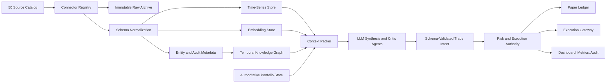

# Multi-Asset LLM Data Pipeline Blueprint

## Purpose

This document defines the future-state migration path from Traidan's current
LLM-only U.S. equity dry-run system to a production multi-asset intelligence
and execution platform. It is intentionally not the active runtime contract.
The current product boundary remains in `architecture.md`: dry-run equity
simulation only, no live capital path, and Rust as the deterministic authority.

The research input is the operator-provided `LLM Trading Data Source Catalog.md`.
The initial machine-readable registry for its 50 sources lives at
`config/alt_data/source_catalog.json`. Future-state contract validators live in
`intelligence/alt_data/contracts.py`; their public JSON schemas live under
`schemas/`.

## Operating Principles

- LLMs produce trading intent only. Deterministic services own validation,
  risk, order construction, execution, accounting, replay protection, and audit.
- Missing, stale, unavailable, or legally restricted data can only reduce risk,
  force hold, or block a route. It must never be converted into synthetic
  directional evidence.
- Runtime payloads must not contain raw prompts, raw logs, credentials, full
  article text, or schema-unknown debug fields.
- Every signal must remain traceable to source metadata, retrieval time,
  freshness, parser version, payload hash, entity links, and evidence IDs.
- Connector credentials and commercial data rights are production gates, not
  implementation details.

## Target Architecture

### Python Intelligence Layer

Python owns non-hot-path ingestion and semantic processing:

- Source connectors, credential lookup, rate-limit discipline, retries, and
  endpoint-specific parsing.
- Raw payload hashing and restricted archive writes.
- Normalized signal extraction for time-series, filings, macro releases, social
  narratives, geospatial events, physical telemetry, and systemic-risk feeds.
- Embeddings, RAG retrieval, source summarization, temporal graph assembly, and
  context packing for the LLM.

### Storage Layer

The platform uses separate stores because the access patterns differ:

- Object storage for immutable raw payloads where licensing permits retention.
- QuestDB for append-only observations and normalized time-series features.
- Postgres for connector metadata, entity registry, instrument master, source
  health, run state, and audit tables.
- A vector store for source summaries, filings, web evidence, and historical
  analog retrieval.
- Graph-style relational tables for entity-event-asset-region dependencies.

### Rust Authority Layer

Rust remains authoritative over anything that can affect portfolio state:

- Strict schema validation and unknown-field rejection.
- Sequence, replay, freshness, and session checks.
- Approved universe checks and instrument-master resolution.
- Risk gates, exposure math, drawdown stops, turnover limits, route selection,
  idempotent order submission, fills, accounting, and kill-safe telemetry.

## Core Interfaces

### `SourceSpec`

The source catalog is a registry of ingestion intent, not a credential store.
Each source entry must include:

- Stable `source_id` and catalog number.
- Category and base URL.
- AI extraction signal.
- Access strategy and authentication mode.
- Data shape and storage policy.
- Production gate text describing what must be true before live use.

The registry starts with all 50 sources from the research catalog. The active
`SourceRegistry` merges those 50 entries with an additive Telegram watchlist
without changing the catalog invariant. Telegram entries must be public,
verified or official, metadata-summary-only, raw-text disabled, and free of
pump/call/unlicensed mirror quality flags. Connectors must be added source by
source behind the registry rather than hard-coded in strategy logic.

### `RawObservationEvent`

Raw retrieval records are immutable and append-only:

- `observation_id`, `source_id`, `retrieved_at`, `event_time`.
- `payload_hash`, `storage_uri`, parser version, HTTP status, and freshness.
- Entity references, instrument references, geographic references, and quality
  flags.
- License/storage classification copied from `SourceSpec`.

### `NormalizedSignalEvent`

Normalized events are the minimum evidence unit available to LLM and quant
pipelines:

- `signal_id`, `source_id`, `observation_id`, `as_of`, `event_time`.
- `asset_refs`, `entity_refs`, `region_refs`, `horizon`, and `signal_family`.
- `direction_hint`, `confidence`, `magnitude`, `freshness`, and quality flags.
- Human-readable summary plus compact evidence refs, never unrestricted raw text.

### `LlmContextPack`

The context pack is the only input passed to the trade-intent LLM:

- Current authoritative portfolio and risk state.
- Approved instrument universe and route capabilities.
- Ranked normalized signals, graph neighborhoods, and historical analogs.
- Explicit unavailable-source flags and stale-source flags.
- Risk limits and action constraints for the cycle.

### `LlmTradeIntent`

The LLM output is advisory until Rust approves it:

- `cycle_id`, `sequence`, `as_of`, `model_id`, `prompt_template_hash`.
- Commands containing instrument ID, direction, target weight, max notional,
  horizon, confidence, thesis, and evidence refs.
- Risk self-assessment and uncertainty notes.
- Required memory updates and next-cycle watch items.

### `RiskApprovedOrder`

Only the Rust authority may produce executable order plans:

- Approved, rejected, or hold verdict.
- Rejection reason or approved parent order ID.
- Child order plan, route, time-in-force, notional/quantity, and limit policy.
- Audit refs back to context pack, LLM intent, risk snapshot, and instrument
  master version.

## Source Families

The catalog is grouped into five ingestion families:

- Core financial infrastructure and fundamentals: SEC EDGAR, J-Quants,
  Finnhub, Tiingo, Nasdaq Data Link, OpenFIGI, EOD Historical Data, Polygon,
  Financial Modeling Prep, and OpenCorporates.
- Global macroeconomics and central bank telemetry: FRED, ECB SDMX, IMF, World
  Bank, OECD, BLS, Bank of England, Bank of Japan, CEIC, and Trading Economics.
- High-velocity public sentiment and narrative tracking: Reddit, LunarCrush,
  Stocktwits, GitHub, NewsAPI, GDELT, LinkUp, Wikimedia Pageviews, Hacker News,
  and Stack Overflow.
- Alternative data and real-world asset vectors: Coresignal, FlightAware,
  Spire Maritime, OpenWeatherMap, MarineTraffic, Glassnode, Sentinel Hub, US
  EIA, CargoMetrics, and Thinknum.
- Systemic interdependence triggers: ACLED, Electricity Maps, USGS Earthquake,
  USDA NASS, ThousandEyes, GDACS, HungerMap LIVE, WHO Global Health, Port of
  Rotterdam, and ACLED CAST.

## Phase-by-Phase Implementation

### Phase 0: Governance and Registry

- Load the 50-source catalog into a versioned registry and validate uniqueness,
  categories, auth modes, storage policies, and production gates.
- Merge additive public Telegram metadata sources from
  `config/alt_data/telegram_watchlist.json` without altering the 50-source
  catalog count.
- Record data-rights status, credential owner, allowed retention class, and
  source freshness SLA before implementing any connector.
- Keep all future-state work outside active dry-run runtime paths until a
  migration phase explicitly updates the active product boundary.

Exit criteria:

- All 50 sources are represented in a tested registry.
- No secrets are present in repo-tracked source metadata.
- Each source has a defined production gate and storage policy.

### Phase 1: Multi-Asset Contract Design

- Add versioned schemas for source specs, raw observations, normalized signals,
  context packs, trade intent, and risk-approved orders.
- Keep existing equity dry-run schemas backward compatible.
- Introduce an instrument master that can map local symbols to FIGI, ISIN,
  CUSIP, SEDOL, venue, asset class, currency, tick size, lot size, session
  calendar, shorting eligibility, and live-route status.

Exit criteria:

- Old equity dry-run payloads still validate.
- New schemas reject unknown fields and raw prompt/log/credential fields.
- Instrument IDs are required before a source can influence trading intent.

### Phase 2: Data Foundation

- Implement connector lifecycle state: configured, credentialed, legal-approved,
  canary, paper-enabled, live-evidence-enabled.
- Persist raw observations by content hash and normalized observations by
  source/event/instrument/time keys.
- Add health metrics for freshness, last success, last failure, rate-limit
  pressure, parse failures, and unavailable-source count.

Exit criteria:

- A source outage produces unavailable evidence, not fabricated data.
- Reprocessing a payload is idempotent.
- Data lineage can reconstruct every normalized event from raw source metadata.

### Phase 3: Connector Waves

- Wave A, financial and identifier sources: implement SEC EDGAR, OpenFIGI, and
  one market-data source first; then add the rest of sources 1-10.
- Wave B, macro sources: implement SDMX and REST macro adapters with consistent
  vintage/revision handling for sources 11-20.
- Wave C, sentiment and web sources: implement source summaries and RAG retrieval
  for sources 21-30 with strict text-length and prompt-injection controls.
- Wave D, physical telemetry: implement geospatial, aviation, maritime, weather,
  energy, and satellite-derived observation handling for sources 31-40.
- Wave E, systemic triggers: implement conflict, disaster, health, food, grid,
  internet, and port-risk signals for sources 41-50.

Exit criteria:

- Every connector has fixtures, malformed-payload tests, rate-limit behavior,
  and source-health metrics.
- Commercial sources remain disabled until credentials and rights are confirmed.

### Phase 4: Semantic Synthesis

- Link observations to entities, instruments, regions, routes, ports, grids,
  executives, subsidiaries, and facilities.
- Generate embeddings for summaries and structured evidence, not unrestricted
  raw source payloads.
- Build graph traversals that can connect upstream physical events to exposed
  instruments without making unsupported causal claims.
- Use a critic pass to reject LLM theses that lack evidence refs or overstate
  causality.

Exit criteria:

- Every LLM thesis cites source evidence IDs.
- Source text is treated as untrusted content.
- Historical analog retrieval returns only time-valid evidence.

### Phase 5: Research, Backtesting, and Paper Canary

- Run event studies and walk-forward tests by source family, asset class,
  horizon, and market regime.
- Model trading costs, spread, slippage, borrow, financing, currency conversion,
  market calendars, corporate actions, and data latency.
- Paper-trade the full LLM-to-risk-to-OMS loop with live market data but no
  capital.

Exit criteria:

- No lookahead or survivorship bias in research pipelines.
- Paper trading reproduces decisions from stored context packs.
- Risk rejects are visible in dashboard and metrics.

### Phase 6: Live Execution Gate

- Add broker and venue adapters behind an `ExecutionGateway` with idempotent
  client order IDs and deterministic retry behavior.
- Enable live routing only by asset class, venue, strategy family, notional cap,
  and operator-approved feature flag.
- Require kill switch, daily loss stop, stale-data stops, broker disconnect
  handling, order reconciliation, and full audit logs.

Exit criteria:

- The LLM cannot access execution credentials or submit orders.
- Rust rejects any order that exceeds risk, venue, borrow, session, freshness,
  or operator limits.
- Live incidents can be reconstructed from immutable context, intent, risk,
  route, order, fill, and telemetry records.

## Testing and Acceptance

- Unit tests for registry validation, connector parsing, source-specific data
  quality rules, schema rejection, and secret scanning.
- Integration tests for connector retries, object-store writes, QuestDB inserts,
  metadata writes, vector indexing, graph linking, and context packing.
- LLM eval tests for evidence citation, hallucination resistance, unavailable
  data handling, prompt-injection resistance, and critic-agent rejection.
- Research tests for lookahead bias, revision/vintage handling, slippage,
  financing, borrow costs, corporate actions, and calendar alignment.
- Execution tests for sequence replay, rejected routes, broker disconnects,
  partial fills, kill switch, idempotent retries, and reconciliation.
- Chaos tests for source outages, rate-limit storms, slow vector retrieval,
  database degradation, clock skew, and stale-source cascades.

## Initial Implementation Boundary

The first implementation slice is intentionally narrow:

- Add the blueprint document.
- Add the 50-source registry.
- Add typed catalog loading and validation.
- Add gated source-registry and connector-plan scaffolding for the 50-source
  catalog plus public Telegram metadata watchlist.
- Add versioned future-state schemas for raw observations, normalized signals,
  LLM context packs, LLM trade intent, and risk-approved orders.
- Add Python validators for those future-state contracts.
- Add tests that make the registry count, families, source IDs, and production
  gates explicit.

No connector performs network I/O in this slice. No active dry-run runtime path
or live execution path changes.
